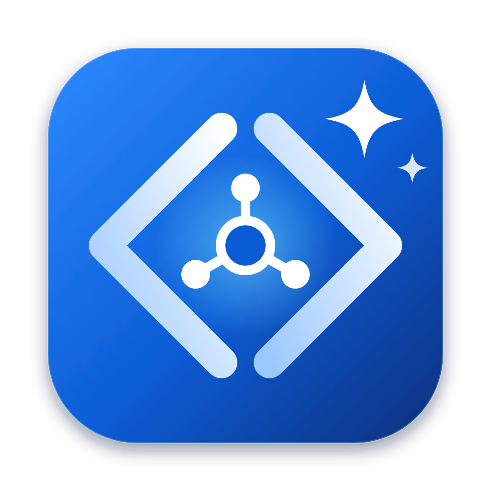

<p align="center">
  
</p>

<h1 align="center">jira-mcp</h1>

<p align="center">
  <strong>A small, auditable MCP server that lets AI assistants talk to Jira Data Center.</strong><br>
  Single static Go binary · Personal Access Token auth · read-only by default
</p>

<p align="center">
  
  
  
  
  <a href="LICENSE"></a>
</p>

---

`jira-mcp` implements the [Model Context Protocol](https://modelcontextprotocol.io) so assistants such as
GitHub Copilot, JetBrains AI Assistant / Junie or Claude Desktop can search, read and (optionally) update
issues on your **self-hosted Jira Data Center / Server**. It is written from scratch against Atlassian's
public REST API v2 and Agile 1.0, and its only third-party dependency is the official
[MCP Go SDK](https://github.com/modelcontextprotocol/go-sdk).

## ✨ Highlights

- **Zero runtime** – one static binary per OS. No Docker, Node, Python or JVM required.
- **Safe by default** – write tools are not even registered unless you opt in. No delete operations exist.
- **Project allowlist** – restrict the assistant to specific projects; JQL is scoped server-side.
- **One-call ticket context** – `jira_get_issue_context` returns description, links, subtasks, comments
  and small text attachments in a single round-trip, ideal for "summarize / implement PLAT-123" prompts.
- **Guided setup** – double-click the app, enter URL + PAT, pick projects, and it writes the MCP config
  for your IDE (native window on macOS/Windows, browser fallback everywhere else).
- **Enterprise-friendly** – custom root CA support, TLS ≥ 1.2, no redirects followed, PAT never logged.

## 🚀 Quick start

### Option A – Desktop app (recommended)

1. Download the archive for your OS from the [Releases](../../releases) page
   (`JiraMCP-macos-arm64.dmg`, `JiraMCP-macos-amd64.zip`, `JiraMCP-windows-amd64.zip`, `JiraMCP-linux-amd64.zip`).
2. Start **Jira MCP** (macOS: right-click → *Open* on first launch, the app is not notarised;
   Windows: SmartScreen → *More info* → *Run anyway*).
3. Enter your **Jira URL** and **Personal Access Token**, click *Next*, tick the projects the assistant may access.
4. Click *Install in GitHub Copilot* (or copy the generated snippet into any other MCP client) and restart your IDE.

Step-by-step guide: [doc/runbooks/desktop-app.md](doc/runbooks/desktop-app.md).

### Option B – Build from source

```sh
git clone <this-repo-url> jira-mcp && cd jira-mcp
go build -o jira-mcp ./cmd/jira-mcp
./jira-mcp            # opens the setup wizard
./jira-mcp serve      # runs the MCP server over stdio (what your IDE launches)
```

Then add it to your MCP client, e.g. VS Code / GitHub Copilot (`mcp.json`):

```json
{
  "inputs": [{ "id": "jira-pat", "type": "promptString", "description": "Jira PAT", "password": true }],
  "servers": {
    "jira": {
      "type": "stdio",
      "command": "/absolute/path/to/jira-mcp",
      "args": ["serve"],
      "env": {
        "JIRA_URL": "https://jira.example.com",
        "JIRA_PERSONAL_TOKEN": "${input:jira-pat}",
        "JIRA_ALLOWED_PROJECTS": "PLAT,CORE"
      }
    }
  }
}
```

More client examples (JetBrains, Claude Desktop): [doc/runbooks/intellij-setup.md](doc/runbooks/intellij-setup.md).

### Try it

> *"Show me my open bugs in PLAT sorted by priority."*
> *"Summarize PLAT-123 including all comments and attachments."*
> *"What is in the current sprint of the CORE board?"*
> *"Move PLAT-123 to In Review and add a comment with the PR link."* (write tools enabled)

## ⚙️ Configuration

Environment variables override the values saved by the setup wizard
(`<user config dir>/jira-mcp/settings.json`, file mode `0600`).

| Variable | Default | Description |
|---|---|---|
| `JIRA_URL` | *required* | Base URL of your Jira instance (`http(s)://…`, context path allowed) |
| `JIRA_PERSONAL_TOKEN` | *required* | Personal Access Token, sent as `Authorization: Bearer`; never logged |
| `JIRA_ENABLE_WRITE_TOOLS` | `false` | `true` registers the write tools below |
| `JIRA_ALLOWED_PROJECTS` | all | Comma-separated project keys, e.g. `PLAT,CORE` |
| `JIRA_HTTP_TIMEOUT_SECONDS` | `30` | Per-request HTTP timeout |
| `JIRA_CUSTOM_CA_CERT_PATH` | – | PEM file with an additional (e.g. corporate) root CA |
| `LOG_LEVEL` | `info` | `debug`, `info`, `warn` or `error` (JSON logs on stderr) |

## 🧰 Tools

| Tool | Kind | Purpose |
|---|---|---|
| `jira_get_myself` | read | Current user behind the PAT |
| `jira_list_projects` | read | Projects visible to the PAT (filtered by allowlist) |
| `jira_search_issues` | read | JQL search, automatically scoped to allowed projects |
| `jira_get_issue` | read | Single issue with selectable fields |
| `jira_get_issue_context` | read | Everything about a ticket in one call |
| `jira_get_issue_comments` | read | Paginated comments |
| `jira_get_issue_transitions` | read | Workflow transitions currently available |
| `jira_get_attachment` | read | Download text/image attachments (≤ 5 MB) |
| `jira_list_boards` | read | Agile boards |
| `jira_list_board_sprints` | read | Sprints of a board |
| `jira_get_sprint_issues` | read | Issues in a sprint |
| `jira_create_issue` | write | Create an issue |
| `jira_update_issue` | write | Update fields of an issue |
| `jira_add_comment` | write | Comment on an issue |
| `jira_transition_issue` | write | Move an issue through its workflow |

Write tools are only available when `JIRA_ENABLE_WRITE_TOOLS=true`.

## 🔒 Security

The assistant is treated as untrusted input. Highlights of the threat model:

- Write tools are absent from `tools/list` unless enabled, and the client refuses writes a second time.
- Issue keys are validated and project-checked; JQL is wrapped as `(<your jql>) AND project IN (…)`.
- Result sizes are capped, redirects are never followed, the PAT is redacted everywhere.
- The setup wizard binds to `127.0.0.1` only and requires a random per-run session token.

Full details: [doc/architecture/02-security-model.md](doc/architecture/02-security-model.md).
Found a vulnerability? Please follow [SECURITY.md](SECURITY.md).

## 🧭 Compatibility

| Product | Supported |
|---|---|
| Jira Data Center / Server with Personal Access Tokens | ✅ |
| Jira Cloud (`/rest/api/3`, email + API token) | ❌ out of scope ([ADR-003](doc/adr/ADR-003-dc-pat-only.md)) |
| Confluence | ❌ out of scope |

## 📚 Documentation

| Topic | Link |
|---|---|
| System overview | [doc/architecture/01-system-overview.md](doc/architecture/01-system-overview.md) |
| Security model | [doc/architecture/02-security-model.md](doc/architecture/02-security-model.md) |
| REST API mapping | [doc/architecture/03-api-mapping.md](doc/architecture/03-api-mapping.md) |
| Architecture decisions | [doc/adr/](doc/adr/) |
| Desktop app runbook | [doc/runbooks/desktop-app.md](doc/runbooks/desktop-app.md) |
| IDE setup | [doc/runbooks/intellij-setup.md](doc/runbooks/intellij-setup.md) |

## 🛠️ Development

```sh
go vet ./... && go test ./...
./scripts/build-release.sh   # cross-compiled binaries, .app bundles and archives in dist/
```

Contributions are welcome — see [CONTRIBUTING.md](CONTRIBUTING.md).

## 📄 License

[MIT](LICENSE) © Hasan Rezvani

*Jira and Atlassian are trademarks of Atlassian Pty Ltd. This project is independent and not affiliated
with or endorsed by Atlassian.*
