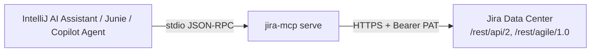
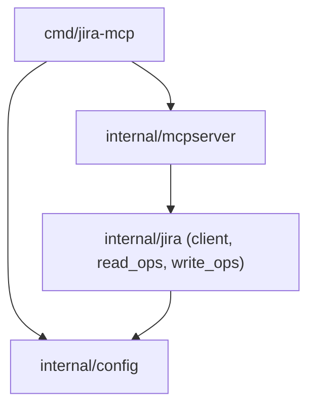
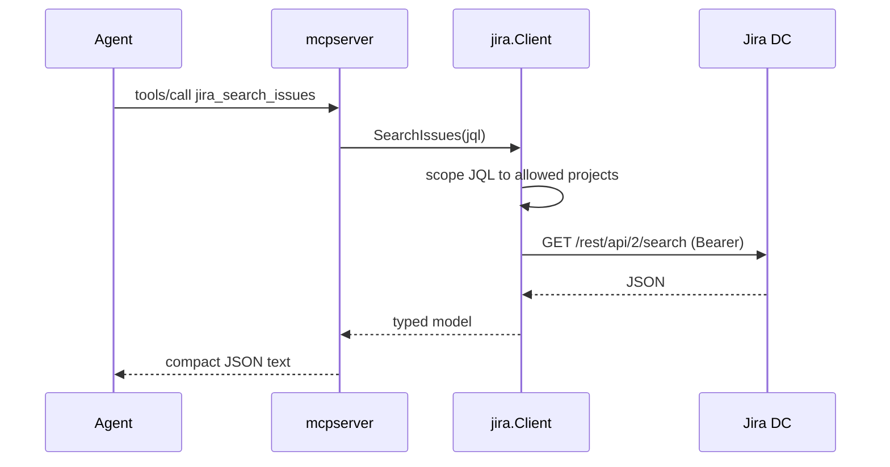

# 01 — System Overview

## Context

Trust boundaries: (1) IDE ↔ jira-mcp process (local process pipe); (2) jira-mcp ↔ Jira (network, TLS). The LLM is untrusted input: all tool arguments are validated and scoped server-side.

## Components

## Request flow

## Stream isolation

`stdout` carries only JSON-RPC frames (owned by the SDK stdio transport). All diagnostics use `log/slog` JSON on `stderr`. Nothing else writes to `stdout`; a stray byte would corrupt the protocol.
